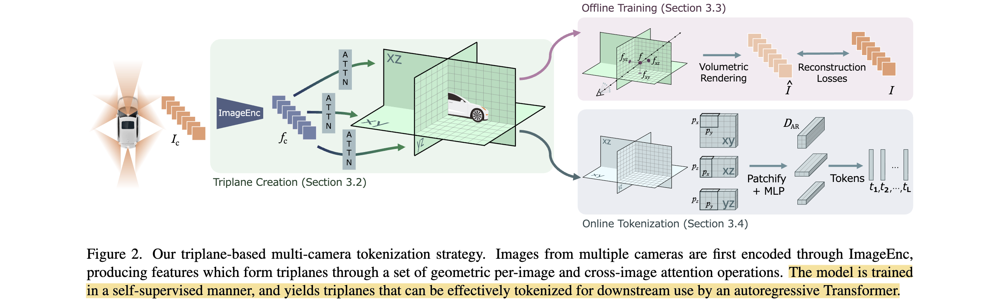
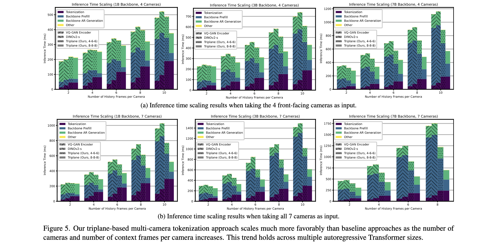

# Efficient Multi-Camera Tokenization with Triplanes for End-to-End Driving

- **Authors:** Boris Ivanovic, Cristiano Saltori, Yurong You, Yan Wang, Wenjie Luo, Marco Pavone
- **Affiliations:** NVIDIA Research, Stanford University
- **Published:** IEEE Robotics and Automation Letters, vol. 10, no. 11, pp. 11713–11720, 2025; arXiv:2506.12251v2
- **Keywords:** autonomous driving, multi-camera tokenization, triplanes, autoregressive Transformer, neural rendering
- **arXiv:** https://arxiv.org/abs/2506.12251

---

## Pass 1 — Bird's-Eye View

| C | Assessment |
|---|---|
| **Category** | Architecture and systems paper on compressing calibrated multi-camera observations into a fixed-size token interface for autoregressive end-to-end driving policies. |
| **Context** | Combines triplane representations from EG3D/K-Planes and multi-camera lifting from TPVFormer with DINOv2 image features, volumetric rendering, and trajectory-token policies. It is positioned against per-image DINOv2 and VQGAN tokenizers as well as structured planners such as [Planning-oriented Autonomous Driving](../../2023/Planning-oriented_Autonomous_Driving/) and VAD. |
| **Correctness** | The matched tokenizer comparisons, A100 timing study, public nuScenes/Waymo evaluations, and small closed-loop study support the efficiency claim. The strongest generality claims remain qualified because the main training corpus and simulator are private, the public comparisons mix architectures and parameter counts, and closed-loop evaluation measures only offroad rate over 75 scenarios. |
| **Contributions** | (1) A camera-count- and resolution-independent triplane bottleneck; (2) self-supervised training from RGB reconstruction; (3) post-training control of token count through plane patchification and halfplane pruning; and (4) evidence of 35–72% token reduction, up to roughly 50% lower inference time, matched or better open-loop accuracy, and lower closed-loop offroad rate. |
| **Clarity** | The representation, geometry, tokenization, and main ablations are clearly described. Exact policy-training hyperparameters, internal data sampling, simulator details, and an official implementation are missing, limiting full reproduction. |



**30-second summary.** The paper lifts calibrated features from every camera into three orthogonal feature planes, self-supervises those planes through neural rendering, and then patchifies the planes into a fixed token sequence for a 1B–7B autoregressive driving policy. Because token count depends on triplane size and patch size rather than the number or resolution of cameras, the aggressive configuration uses 45 tokens per image-equivalent instead of 160, while retaining similar internal open-loop accuracy and reducing the DINOv2 baseline's 20-second closed-loop offroad rate from 4.0% to 2.7%. The design is a practical geometric compression interface, although its calibration dependence, per-timestep processing, and private main benchmark leave important deployment questions open.

---

## Pass 2 — Careful Read

### Core Idea in One Sentence

Lift all calibrated camera images into one fixed-resolution 3D-aware triplane, then patchify that shared representation so an autoregressive policy receives far fewer tokens regardless of camera count or input resolution.

### Method / Approach

- **Geometric multi-camera lifting:** Encode each image with DINOv2-Small, project learned 3D queries into each calibrated view, and use two rounds of per-image plus cross-image deformable attention to aggregate features across cameras.
- **Triplane bottleneck:** Average the updated 3D query volume along each spatial axis to form $P_{xy}$ , $P_{xz}$ , and $P_{yz}$ with fixed sizes $96 \times 96$ , $96 \times 48$ , and $96 \times 48$ and feature width 192; a bilinear spatial parameterization gives dense cells near the ego vehicle and coarser cells farther away.
- **Self-supervised pretraining:** Query the triplanes along camera rays, decode color and density with a lightweight MLP, and minimize equal-weight LPIPS[^3] and pixel $L_1$ reconstruction losses; no driving labels or adversarial loss are needed for tokenizer pretraining.
- **Adjustable downstream tokens:** Patchify the three planes and linearly project each patch to the policy width. Patch sizes $(4,6,6)$ or $(8,8,8)$ yield different speed–accuracy points, and unused rear halves can be removed when only front cameras are used.

#### Train Data

| Name | Usage |
|---|---|
| Internal 20,000-hour multi-country driving dataset | Self-supervised tokenizer pretraining and trajectory-policy training; geographically partitioned into 90% train/validation and 10% test. |
| nuScenes | Public train split for the standardized three-second open-loop planning experiment. |
| Waymo Open Dataset | Dataset-specific trajectory-policy training for the appendix experiment; the paper identifies the validation split for evaluation but does not state the training split explicitly. |
| ImageNet-1k | Pretraining source for the ResNet-50 image-encoder ablation. |

#### Evaluation/Validation Data

| Name | Usage |
|---|---|
| Internal geographically separated driving holdout | Main triplane reconstruction and open-loop minADE$_6$ evaluation. |
| nuScenes | Validation split for three-second open-loop trajectory L2 comparison. |
| Waymo Open Dataset | Validation split for five-second open-loop trajectory L2 comparison. |
| Internal neural-reconstruction simulator | 75 mined, interactive 20-second closed-loop scenarios evaluated by offroad rate. |

### Key Results



| Evaluation | Method | Tokens/image-equivalent ↓ | Result ↓ | Notes |
|---|---|---:|---:|---|
| Internal open loop, minADE$_6$ @5 s | VQGAN encoder | 160 | 0.74 m | 1B policy, 4 cameras × 6 frames |
| Internal open loop, minADE$_6$ @5 s | DINOv2-Small | 160 | 0.69 m | matched patch-token baseline |
| Internal open loop, minADE$_6$ @5 s | Triplane (8-8-8) | **45** | 0.72 m | 72% fewer tokens |
| Internal open loop, minADE$_6$ @5 s | **Triplane (4-6-6)** | **104** | **0.67 m** | 35% fewer tokens |
| nuScenes open loop, average L2 @1/2/3 s | DINOv2-Small + 1B | 160 | 0.73 m | public standardized setup |
| nuScenes open loop, average L2 @1/2/3 s | **Triplane (4-6-6) + 1B** | **104** | **0.66 m** | close to PARA-Drive 0.66; below DiMA 7B 0.57 |
| Waymo open loop, average L2 @1/3/5 s | DINOv2-Small + 1B | 160 | 1.17 m | validation split |
| Waymo open loop, average L2 @1/3/5 s | **Triplane (8-8-8) + 1B** | **45** | **0.83 m** | aggressive tokenization is slightly better than (4-6-6), 0.86 m |
| Internal closed loop, offroad @20 s | DINOv2-Small + 1B | 160 | 4.0% | 75 scenarios |
| Internal closed loop, offroad @20 s | **Triplane (8-8-8) + 1B** | **45** | **2.7%** | one rollout per scenario; no uncertainty reported |

Ablation and systems highlights:

- Seven-camera reconstruction reaches 28.94 dB PSNR[^4] / 0.84 SSIM[^5] with DINOv2-Small; four-camera reconstruction reaches 29.15 dB / 0.85.
- A ResNet-50 encoder improves reconstruction slightly (29.34 dB / 0.85 for seven cameras) but runs slower, so DINOv2-Small is used elsewhere.
- At 3.6× input pixel count, the unchanged triplane has 28.00 dB / 0.82 SSIM and preserves downstream driving accuracy.
- With seven cameras, the triplane policy remains within 2.5% of its four-camera minADE$_6$ , while the raw DINOv2-token baseline degrades by 18% and becomes unstable to train.
- Timing over 100 A100 80 GB forward passes shows tokenizer overhead is outweighed by shorter Transformer prefill; the advantage grows with cameras, temporal context, and policy size, reaching roughly 50% end-to-end savings in large settings.

### Strengths

- **Geometry-aware compression:** Adjacent camera overlap is fused before the policy, rather than represented repeatedly in independent patch sequences.
- **Fixed downstream interface:** Camera count and resolution change encoder work but not the triplane dimensions or downstream token budget.
- **Label-efficient tokenizer:** RGB reconstruction supplies the main supervision, avoiding 3D boxes, depth, occupancy, maps, or driving actions during tokenizer pretraining.
- **Post-training deployment control:** Patch size and halfplane pruning can change token count without retraining the triplane encoder.
- **Multiple evaluation stages:** The paper reports reconstruction, internal and public open-loop planning, hardware timing, camera/resolution scaling, and a limited interactive closed-loop test.

### Weaknesses / Open Questions

1. **Calibration dependence:** The lifting operation requires accurate intrinsics and extrinsics; robustness to calibration drift, camera replacement, timing skew, and missing cameras is not tested.
2. **Per-timestep representation:** Each time step is encoded independently, so temporal redundancy is not compressed until the downstream policy and token count still grows linearly with history length.
3. **Private primary evidence:** The 20,000-hour corpus, held-out geography, simulator, scenario mining, and map labels are unavailable.
4. **Narrow closed-loop metric:** Offroad rate does not measure collisions, progress, comfort, traffic-rule compliance, or interventions; 75 scenarios and no repeated stochastic trials are insufficient for broad safety conclusions.
5. **Confounded public SOTA table:** UniAD, VAD, PARA-Drive, TOKEN, and DiMA differ in architecture, supervision, and parameter count; only DINOv2/VQGAN versus triplane is a controlled tokenizer comparison.
6. **Representation ceiling:** Fixed planes spend capacity on empty space and use a predetermined spatial basis; higher resolution lowers PSNR when plane capacity is held fixed.
7. **No released implementation:** Exact deformable-attention settings, optimizer schedules, trajectory vocabulary, sampling strategy, and simulator integration cannot be reconstructed from the paper alone.

### References to Follow Up

1. **Tri-Perspective View for Vision-Based 3D Semantic Occupancy Prediction** — Huang et al., CVPR 2023: TPVFormer supplies the multi-camera-to-triplane lifting pattern adapted here.
2. **K-Planes: Explicit Radiance Fields in Space, Time, and Appearance** — Fridovich-Keil et al., CVPR 2023: Generalizes factorized planes to dynamic radiance fields and clarifies what triplanes gain and constrain.
3. **MoST: Multi-Modality Scene Tokenization for Motion Prediction** — Mu et al., CVPR 2024: Relevant autoencoder-based scene-tokenization alternative.
4. **[DriveVLM: The Convergence of Autonomous Driving and Large Vision-Language Models](../../2024/DriveVLM-_The_Convergence_of_Autonomous_Driving_and_Large_Vision-Language_Models/)** — Tian et al., CoRL 2024: Demonstrates why token count and latency matter in a deployed large-model driving stack.
5. **[Towards Efficient and Effective Multi-Camera Encoding for End-to-End Driving](../Towards_Efficient_and_Effective_Multi-Camera_Encoding_for_End-to-End_Driving/)** — Yang et al., arXiv 2025: Direct geometry-free successor that compares against triplanes and challenges the need for the fixed 3D prior.

---

## Pass 3 — Virtual Re-implementation

### Detailed Technical Summary

**Inputs and coordinate system.** At time $t$ , receive $N$ RGB images $I_c \in R^{H \times W \times 3}$ plus every camera's intrinsic and ego-relative extrinsic calibration. The default data has seven cameras at $320 \times 512$ and 10 Hz, while the planning experiment uses four front cameras over six frames. All triplane cells live in an ego-centered coordinate system.

**Image features.** Apply a shared 22M-parameter DINOv2-Small encoder to every camera:

```math
f_c = ImageEnc(I_c), \quad f_c \in R^{H_f \times W_f \times D_f}
```

The paper also tests ImageNet-pretrained ResNet-50. DINOv2 is selected for the system experiments because its slightly weaker reconstruction is offset by better runtime.

**3D query lifting.** Initialize learned queries on a $S_x \times S_y \times S_z$ grid. Project every 3D query into each camera using calibration, then apply two sets of per-image and cross-image deformable-attention layers—four attention layers and 6.5M parameters total. Sinusoidal position encodings identify query locations. Cross-camera fusion happens here, before any policy tokens are formed.

**Triplane collapse.** Average the final 3D query tensor along each axis to obtain three orthogonal planes:

```math
P_{xy} \in R^{S_x \times S_y \times D_f}, \quad
P_{xz} \in R^{S_x \times S_z \times D_f}, \quad
P_{yz} \in R^{S_y \times S_z \times D_f}
```

The reported configuration uses $S_x=S_y=96$ , $S_z=48$ , and $D_f=192$ . It covers $[-180,180]$ m laterally/longitudinally and $[-3,45]$ m vertically. A piecewise-linear coordinate map uses an inner resolution $R_i$ for 36 central cells per horizontal half-axis and a coarser outer resolution $R_o$ beyond them, concentrating representational capacity near the vehicle without enlarging the planes.

**Volumetric rendering objective.** To train the tokenizer, sample camera rays and 3D points. Project a point $x \in R^3$ onto all three planes, bilinearly interpolate features $f_{xy}$ , $f_{xz}$ , and $f_{yz}$ , combine them by elementwise multiplication, and decode color and density with a lightweight MLP. Standard volume rendering produces $\hat{I}$ . The only required loss is:

```math
L(I,\hat{I}) = \lambda_{LPIPS} L_{LPIPS}(I,\hat{I}) + \lambda_1 \|I-\hat{I}\|_1
```

with $\lambda_{LPIPS}=\lambda_1=0.5$ . The appendix optionally adds $L_{depth}=\lambda_d\|d-\hat{d}\|_1$ using Depth Anything V2 pseudo-depth, but this is not part of the primary driving results.

**Continuous tokenization.** For each plane $P_{ij}$ , reshape non-overlapping $p_i \times p_j$ feature patches into vectors of width $D_f p_i p_j$ and apply a one-layer MLP to reach policy width $D_{AR}$ . The plane produces

```math
L_{ij} = \frac{S_i}{p_i}\frac{S_j}{p_j}
```

tokens, and $L=L_{xy}+L_{xz}+L_{yz}$ across the triplane. The paper reports continuous tokens only: adding finite scalar quantization to obtain discrete codes underperformed in preliminary experiments.

**Halfplane pruning.** If every active camera faces forward, the rear halves of $P_{xy}$ and $P_{xz}$ are unobserved and can be removed after encoding. This reduces token count by 37.5% for $(4,6,6)$ patches and 40.9% for $(8,8,8)$ patches. It is an input-rig-specific optimization, not part of the camera-agnostic representation itself.

**Trajectory policy.** A randomly initialized LLM-like autoregressive Transformer consumes the visual tokens plus past ego-trajectory tokens. Its output is a sequence of discrete future-trajectory tokens decoded to ego positions at 10 Hz. The controlled main comparison uses a 1B model with width $D_{AR}=2048$ , four cameras, and six frames; timing also profiles 3B and 7B variants.

**Training stages.** First pretrain VQGAN or triplane tokenizers on images; DINOv2 remains internet-pretrained. Next train the autoregressive policy on frozen tokenizer outputs. Finally train the combined tokenizer-policy with next-trajectory-token prediction loss. The paper calls this a multi-stage pipeline but defers most learning-rate, batch-size, duration, and optimizer settings to an NVIDIA presentation rather than specifying them in the archival text.

**Evaluation protocol.** Reconstruction uses PSNR and SSIM. Internal open-loop planning reports minADE$_6$ at 1, 3, and 5 seconds. nuScenes reports trajectory L2 at 1, 2, and 3 seconds after two seconds of image history; Waymo reports 1, 3, and 5 seconds after one second of history. Runtime is averaged over 100 single-A100-80GB forward passes. Closed-loop evaluation runs 75 mined 20-second simulator scenarios and records whether the vehicle leaves the road by 6, 12, and 20 seconds.

### Datasets

#### Train Data

| Dataset | Usage | Proposed by |
|---|---|---|
| Internal 20,000-hour multi-country driving dataset | Self-supervised triplane/VQGAN tokenizer pretraining and trajectory-policy training on the 90% train/validation partition; optional Depth Anything V2 pseudo-depth experiment uses the same images. | — |
| nuScenes | Public train split for the standardized three-second open-loop planning experiment. | nuScenes |
| Waymo Open Dataset | Dataset-specific five-second planning experiment; evaluation uses the validation split, while the exact training split is not explicitly stated. | Waymo Open Dataset |
| ImageNet-1k | Pretraining source for the ResNet-50 image-encoder reconstruction ablation. | ImageNet |

#### Evaluation/Validation Data

| Dataset | Usage | Proposed by |
|---|---|---|
| Internal geographically separated driving holdout | 10% held-out partition for reconstruction quality and internal open-loop minADE$_6$ . | — |
| nuScenes | Validation split for public three-second open-loop trajectory L2 comparisons. | nuScenes |
| Waymo Open Dataset | Validation split for public five-second open-loop trajectory L2 comparisons. | Waymo Open Dataset |
| Internal neural-reconstruction simulator scenarios | 75 interaction-heavy, 20-second closed-loop rollouts evaluated by offroad rate. | — |

### Hidden Assumptions

1. **Reliable calibration:** Intrinsics and extrinsics are sufficiently accurate and stable for 3D query projection; real-vehicle vibration and recalibration are ignored.
2. **Rendering quality tracks planning utility:** Reconstructing RGB pixels is assumed to preserve action-relevant details, even though photometric losses can prioritize texture and sky over small hazards.
3. **Fixed ego-aligned volume fits deployment:** The chosen 360 m × 360 m × 48 m support and bilinear resolution are assumed to cover the relevant operating domain across highways, cities, and camera rigs.
4. **Average projection preserves vertical structure:** Collapsing a 3D query volume into three axis-aligned means is assumed not to erase information required for planning.
5. **Policy prefill dominates:** The tokenizer's extra lifting/rendering-side compute is worthwhile only when autoregressive prefill remains the system bottleneck.
6. **Best-of-six open-loop error is meaningful:** minADE$_6$ rewards having one accurate sample and does not test which trajectory a vehicle would actually execute.
7. **Offroad rate approximates closed-loop quality:** Remaining on-road is treated as the primary safety signal despite possible collisions, deadlocks, discomfort, or rule violations.

### Reproducibility Notes

- **Source artifact:** The complete locally extracted paper is stored in `resources/paper.md`; no third-party conversion was used.
- **Public data:** nuScenes and Waymo Open Dataset evaluations are named, but the exact data preprocessing and training recipe are incomplete.
- **Private dependencies:** The 20,000-hour corpus, geographic split, closed-loop simulator, 75 scenarios, and map labels are unavailable.
- **Specified architecture:** DINOv2-Small; four deformable-attention layers totaling 6.5M parameters; $96 \times 96 \times 48$ query grid; feature width 192; triplane spatial bounds; 1B policy width 2048; patch sizes; and reconstruction-loss weights.
- **Missing optimization details:** Optimizers, learning rates, batch sizes, training iterations, augmentation, freeze/unfreeze schedule, trajectory vocabulary, and sampling/decoding settings are not fully reported.
- **Timing protocol:** Single A100 80 GB, 100 forward passes, confidence intervals within 0.5 ms. Batch size, precision, compilation, and data-transfer inclusion remain unspecified.
- **Code and weights:** No official repository or model release was identified; third-party reimplementations should not be treated as author-verified reproduction.

### Ideas for Future Work

1. **Spatiotemporal planes:** Encode multiple timesteps into K-planes or recurrent triplane state so history length does not linearly increase policy tokens.
2. **Calibration robustness:** Train with perturbed intrinsics/extrinsics, dropped cameras, and synchronization errors, then test zero-shot rig transfer.
3. **Task-aware compression:** Combine rendering with occupancy, semantics, trajectory, or risk-weighted losses to preserve small action-critical objects.
4. **Adaptive sparse planes:** Allocate cells or tokens according to observed content and uncertainty rather than a fixed axis-aligned grid.
5. **Public closed-loop benchmark:** Integrate with NAVSIM, Bench2Drive, or another reproducible simulator and report collisions, progress, comfort, and rules in addition to offroad rate.
6. **On-vehicle profiling:** Measure end-to-end latency, memory, and energy on automotive accelerators with TensorRT and realistic camera pipelines.
7. **Hybrid with learned scene tokens:** Test whether triplane tokens can initialize or supervise a smaller geometry-free bottleneck, combining calibration efficiency with flexible allocation.

---

## Pass 4 — Modern Perspective Review (as of October 2026)

### What Has Changed Since Publication

- **A direct geometry-free challenger appeared:** [Towards Efficient and Effective Multi-Camera Encoding for End-to-End Driving](../Towards_Efficient_and_Effective_Multi-Camera_Encoding_for_End-to-End_Driving/) replaces fixed planes and calibration with jointly learned scene tokens. On the same broad internal-data setting, it reports better minADE$_6$ and fewer policy tokens than the triplane configurations, although the comparison is not stage- or architecture-matched.
- **The tokenizer entered a larger driving stack:** Alpamayo-R1 explicitly supports the triplane multi-camera tokenizer as an alternative visual interface, evidence that the method is useful as a modular component rather than only a paper-specific experiment.
- **Evaluation expectations have risen:** Public open-loop L2/minADE remains useful for controlled ablations, but current driving-policy work increasingly distinguishes open-loop prediction, closed-loop simulation, and final-pipeline performance. The paper deserves credit for including closed loop, though its private offroad-only protocol is now visibly incomplete.
- **Token compression remains central:** Larger VLA[^2] policies and longer video contexts make prefill cost more severe, strengthening the practical motivation. At the same time, learned latent resamplers and dynamic token pruning offer less geometry-bound alternatives.

### Has the Community Accepted the Claims?

The narrow claim—that a fixed geometry-aware intermediate representation can reduce camera-token redundancy and improve system throughput without sacrificing the tested planning metrics—is well supported and has been adopted by at least one later large driving stack. The stronger implication that triplanes are the preferred general interface is unsettled. Flex directly challenges the fixed 3D prior and reports a stronger efficiency–accuracy trade-off, while neither work offers a public, matched, closed-loop comparison. The current evidence supports triplanes as a credible deployable option when calibration is available, not as the final answer to multi-camera tokenization.

---

### Comparison Papers

#### Predecessors

| Paper | Authors | Year | Relation |
|---|---|---:|---|
| Efficient Geometry-Aware 3D Generative Adversarial Networks (EG3D) | Chan et al. | 2022 | Establishes the triplane representation and feature querying used as the geometric bottleneck. |
| K-Planes: Explicit Radiance Fields in Space, Time, and Appearance | Fridovich-Keil et al. | 2023 | General factorized plane representation for spatial and temporal neural fields. |
| Tri-Perspective View for Vision-Based 3D Semantic Occupancy Prediction | Huang et al. | 2023 | Supplies a closely related calibrated multi-camera lifting mechanism for three perspective planes. |
| MoST: Multi-Modality Scene Tokenization for Motion Prediction | Mu et al. | 2024 | Scene-tokenization predecessor using autoencoded sensor representations. |
| [DriveVLM: The Convergence of Autonomous Driving and Large Vision-Language Models](../../2024/DriveVLM-_The_Convergence_of_Autonomous_Driving_and_Large_Vision-Language_Models/) | Tian et al. | 2024 | Motivates large autoregressive driving backbones and the need for aggressive visual-token reduction. |

#### Contemporaries / Competitors

| Paper | Authors | Year | Relation |
|---|---|---:|---|
| DINOv2: Learning Robust Visual Features without Supervision | Oquab et al. | 2024 | Controlled per-image patch-token baseline; 160 tokens per image after resizing. |
| Taming Transformers for High-Resolution Image Synthesis (VQGAN) | Esser et al. | 2021 | Controlled autoencoder-token baseline; also produces 160 tokens per image. |
| [Planning-oriented Autonomous Driving](../../2023/Planning-oriented_Autonomous_Driving/) | Hu et al. | 2023 | UniAD baseline on nuScenes; uses a structured BEV[^1] pipeline rather than an LLM-like policy. |
| VAD: Vectorized Scene Representation for Efficient Autonomous Driving | Jiang et al. | 2023 | Vectorized end-to-end planning baseline on nuScenes. |
| PARA-Drive: Parallelized Architecture for Real-time Autonomous Driving | Weng et al. | 2024 | Strong public nuScenes baseline and source of the standardized comparison protocol. |
| Distilling Multi-Modal Large Language Models for Autonomous Driving (DiMA) | Hegde et al. | 2025 | 7B-policy competitor with better nuScenes trajectory L2 but a larger policy and different supervision. |

#### Successors / Extensions

| Paper | Authors | Year | Relation |
|---|---|---:|---|
| [Towards Efficient and Effective Multi-Camera Encoding for End-to-End Driving](../Towards_Efficient_and_Effective_Multi-Camera_Encoding_for_End-to-End_Driving/) | Yang et al. | 2025 | Direct successor/challenger: compares against this triplane tokenizer and replaces its 3D prior with learned holistic scene tokens. |
| Alpamayo-R1: Bridging Reasoning and Action Prediction for Generalizable Autonomous Driving in the Long Tail | NVIDIA et al. | 2025 | Integrates this triplane tokenizer as an optional multi-camera interface in a larger reasoning-and-action system. |

---

### Bottom Line

This is a useful reference for anyone designing the visual interface to a large autonomous-driving policy. Its most durable lesson is not simply “use triplanes,” but that camera redundancy should be fused before expensive Transformer prefill and that the compression interface should be evaluated at the full-system level. The paper backs that lesson with unusually broad evidence spanning reconstruction, public and private open-loop tests, A100 timing, and a small closed-loop evaluation. It is partly superseded as the efficiency frontier by Flex's learned scene tokens, but the geometric design remains attractive when calibration is reliable, spatial grounding matters, and predictable token budgets are more valuable than representation flexibility.

[^1]: **BEV** — Bird's-Eye-View representation. See the [glossary](../../common/terms/).
[^2]: **VLA** — Vision-Language-Action model. See the [glossary](../../common/terms/).
[^3]: **LPIPS** — Learned Perceptual Image Patch Similarity. See the [glossary](../../common/terms/).
[^4]: **PSNR** — Peak Signal-to-Noise Ratio. See the [glossary](../../common/terms/).
[^5]: **SSIM** — Structural Similarity Index Measure. See the [glossary](../../common/terms/).
