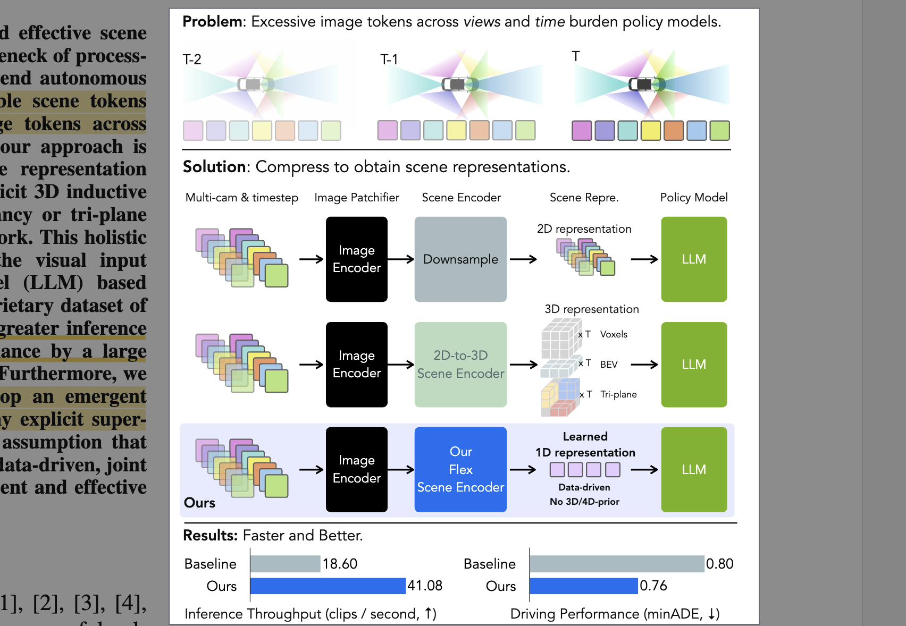
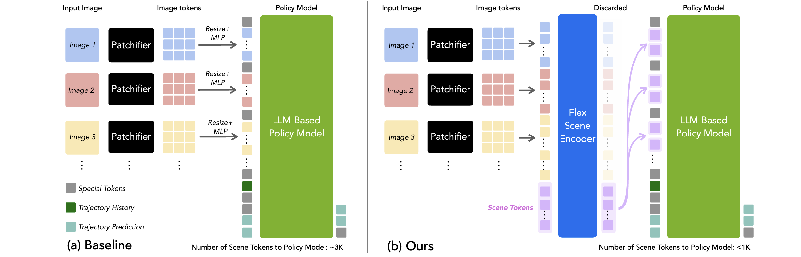

# Towards Efficient and Effective Multi-Camera Encoding for End-to-End Driving

- **Authors:** Jiawei Yang, Ziyu Chen, Yurong You, Yan Wang, Yiming Li, Yuxiao Chen, Boyi Li, Boris Ivanovic, Marco Pavone, Yue Wang
- **Affiliations:** USC Physical Superintelligence Lab, Stanford University, NVIDIA Research
- **Published:** arXiv:2512.10947v2, December 12, 2025
- **Keywords:** end-to-end autonomous driving, multi-camera encoding, visual token compression, scene representation, Vision-Language-Action model
- **Webpage:** https://jiawei-yang.github.io/Flex
- **arXiv:** https://arxiv.org/abs/2512.10947

---

## Pass 1 — Bird's-Eye View

| C | Assessment |
|---|---|
| **Category** | Architecture and systems paper for efficient camera encoding in end-to-end autonomous driving. It proposes a learned visual-token bottleneck and evaluates both trajectory accuracy and computational efficiency. |
| **Context** | Builds on latent-query compression in Perceiver, Flamingo, and TokenLearner; frozen DINOv2 image features; and driving encoders based on [BEVFormer](../../2022/BEVFormer-_Learning_Bird's-Eye-View_Representation_from_Multi-Camera_Images_via_Spatiotemporal_Transformers/) (a BEV[^2] encoder), occupancy, and triplanes. It directly contrasts with [Efficient Multi-Camera Tokenization with Triplanes for End-to-End Driving](../Efficient_Multi-Camera_Tokenization_with_Triplanes_for_End-to-End_Driving/). |
| **Correctness** | The controlled in-house baseline and extensive ablations support the claim that joint learned compression improves this particular system. The broader claim that explicit 3D priors are unnecessary is not established generally because evaluation uses one proprietary dataset, one open-loop metric, and no public or closed-loop benchmark. |
| **Contributions** | (1) Flex, an 8-layer geometry-agnostic Transformer that compresses all camera-time image tokens into a shared learned token set; (2) interleaved prediction that supervises every temporal prefix; (3) a reported 2.2× throughput gain, 42% lower training cost, and better minADE$_6$ than an otherwise matched VLA[^1] baseline; and (4) attention visualizations suggesting emergent token specialization. |
| **Clarity** | The main architecture and ablations are concise and easy to follow. Reproducibility is limited by the unnamed private dataset, unavailable implementation, underspecified image encoder details, and missing latency hardware/protocol details. |



**30-second summary.** Flex replaces thousands of flattened multi-camera, multi-timestep image tokens with 900 learned scene tokens. A lightweight Transformer jointly self-attends over the learned tokens and every image token, after which the image tokens are discarded and only the compressed scene tokens enter a Qwen2-0.5B policy. On a proprietary 20,000-hour driving dataset, Flex improves full-training minADE$_6$ from 0.798 to 0.761, raises throughput from 18.60 to 41.08 clips/s, and cuts reported training from 5,750 to 3,318 A100 GPU-hours. The result is compelling evidence for joint token compression, but not yet for public-benchmark generalization or closed-loop driving safety.

---

## Pass 2 — Careful Read

### Core Idea in One Sentence



Jointly compress every camera and timestep into one small, geometry-free set of learned scene tokens before the expensive policy model, so the encoder can remove cross-view and temporal redundancy end to end.

### Method / Approach

- **Matched VLA baseline:** A frozen DINOv2 patchifier produces 640 tokens per image, bilinearly downsamples them to 160, and projects the concatenated camera-time sequence into a pretrained Qwen2-0.5B policy that autoregressively predicts discretized future waypoints.
- **Holistic Flex encoder:** Prepend $K$ learned scene tokens to all image tokens, add learned camera and timestep embeddings, and apply $L=8$ layers of full joint self-attention. Discard the updated image tokens and send only the 900 scene tokens to the policy.
- **Interleaved prediction:** Supervise trajectory prediction at every temporal prefix rather than only at the last frame, producing $T$ training signals from a length-$T$ clip while masking earlier history/future targets from the final prediction.
- **Implicit temporal allocation:** Split the holistic scene-token sequence evenly into $T$ chunks; prefix $k$ of the interleaved objective consumes the first $k$ chunks. No explicit loss assigns tokens to times or semantics.

#### Train Data

| Name | Usage |
|---|---|
| Internal 20,000-hour multi-country driving dataset | Stage-1 training and Stage-2 end-to-end fine-tuning on the 90% train/validation partition; logs cover more than 1,700 cities in 25 countries. |

#### Evaluation/Validation Data

| Name | Usage |
|---|---|
| Internal 20,000-hour multi-country driving dataset | Validation is included in the 90% train/validation partition; the exact internal allocation is not reported. |
| Internal geographically separated holdout | 10% test partition for minADE$_6$ and system comparisons. |

### Key Results

| Method | Training stage | Cameras × timesteps | Scene tokens | minADE$_6$ ↓ | Training (A100 GPU-h) ↓ | Throughput (clips/s) ↑ |
|---|---:|---:|---:|---:|---:|---:|
| Triplane (8-8-8) | Stage 1 | 4 × 6 | 1,080 | 1.046 | 4,984 | 69.62 |
| Triplane (4-6-6) | Stage 1 | 4 × 6 | 2,496 | 0.974 | 7,960 | 64.53 |
| In-house VLA | Stage 1 | 2 × 9 | 2,880 | 0.818 | 4,134 | 18.60 |
| **Flex** | Stage 1 | 2 × 9 | **900** | **0.794** | **2,260** | **41.08** |
| In-house VLA | Stage 1 + 2 | 2 × 9 | 2,880 | 0.798 | 5,750 | 18.60 |
| **Flex** | Stage 1 + 2 | 2 × 9 | **900** | **0.761** | **3,318** | **41.08** |

The triplane rows are not controlled comparisons: they use Llama2-1B, four cameras over six timesteps, training from scratch, and non-interleaved prediction.

Ablation highlights:

- Joint self-attention is the best tested encoder: minADE$_6$ 0.833 at 41.08 clips/s, versus 0.844 for per-image joint attention, 0.966 for per-image cross-attention, and 1.032 for holistic cross-attention.
- Interleaving improves the matched baseline from 0.894 to 0.860 and Flex from 0.991 to 0.833 with effectively unchanged throughput.
- Accuracy improves almost monotonically from 144 to roughly 900 scene tokens, then saturates; policy throughput falls as token count grows.
- Eight encoder layers provide the selected accuracy/throughput balance; 16 layers add little.
- As cameras increase from 2 to 7, baseline minADE$_6$ worsens from 0.860 to 0.925 and throughput drops from 18.60 to 3.34 clips/s. Flex remains near 0.83 while throughput drops from 41.08 to 11.40 clips/s.

### Strengths

- **Clean controlled baseline:** Flex and the in-house VLA share the patchifier, policy, trajectory encoding, and training schedule, isolating the effect of the scene encoder better than the triplane comparison does.
- **System-level efficiency:** The work reports policy token count, end-to-end training cost, and inference throughput rather than only scene-encoder FLOPs.
- **Useful ablation coverage:** Token count, patchifier size, encoder depth, attention topology, temporal supervision, and camera count are all varied.
- **Minimal calibration dependency:** Flex uses camera identity and timestep embeddings, but no camera intrinsics, extrinsics, BEV grid, voxel grid, or explicit 3D supervision.
- **Configurable bottleneck:** The number of scene tokens offers a smooth deployment trade-off instead of a fixed spatial discretization.

### Weaknesses / Open Questions

1. **Private data and metrics:** The only dataset is proprietary and unnamed, so neither the data distribution nor the reported minADE$_6$ can be independently reproduced.
2. **Open-loop evidence only:** Lower trajectory displacement error does not demonstrate closed-loop safety, collision avoidance, recovery, or causal use of visual evidence.
3. **Over-broad geometry claim:** Flex shows that explicit geometry is unnecessary for this model/data/metric combination, not that 3D priors are unnecessary under less data, stronger spatial tasks, calibration shifts, or rare safety-critical situations.
4. **Limited surround-view stress test:** The default uses front-wide and front-telephoto cameras. The authors acknowledge that the test split does not emphasize rare cases requiring side or rear views.
5. **Attention is not explanation:** Highlighted attention maps are suggestive, but there is no causal intervention showing that named tokens encode destination, lanes, or intention.
6. **Unclear throughput protocol:** The paper reports clips/s but does not state the inference accelerator, batch size, precision, compilation, or whether every preprocessing cost is included.
7. **No public artifacts:** The project page links the paper but provides no official code, weights, or dataset as of October 2026.

### References to Follow Up

1. **[Efficient Multi-Camera Tokenization with Triplanes for End-to-End Driving](../Efficient_Multi-Camera_Tokenization_with_Triplanes_for_End-to-End_Driving/)** — Ivanovic et al., IEEE RA-L 2025: Flex's principal geometry-aware scene-tokenization baseline.
2. **Perceiver: General Perception with Iterative Attention** — Jaegle et al., ICML 2021: Establishes fixed-size latent arrays for compressing high-dimensional inputs.
3. **Flamingo: A Visual Language Model for Few-Shot Learning** — Alayrac et al., NeurIPS 2022: Uses a Perceiver Resampler to turn variable visual inputs into a compact token set for a language model.
4. **[BEVFormer: Learning Bird's-Eye-View Representation from Multi-Camera Images via Spatiotemporal Transformers](../../2022/BEVFormer-_Learning_Bird's-Eye-View_Representation_from_Multi-Camera_Images_via_Spatiotemporal_Transformers/)** — Li et al., ECCV 2022: Canonical explicit-BEV alternative for spatiotemporal multi-camera aggregation.
5. **LVSM: A Large View Synthesis Model with Minimal 3D Inductive Bias** — Jin et al., ICLR 2025: Closely related learned 1D scene representation outside driving.

---

## Pass 3 — Virtual Re-implementation

### Detailed Technical Summary

**Task and inputs.** For camera set $C$ and a fixed temporal window $T$ covering roughly two seconds, the observation contains RGB images $I_{c,t} \in R^{H \times W \times 3}$ and recent ego-state history $s_{T-h:T}$ . The target is an ego-frame future trajectory $Y = \{y_t\}_{t=T+1}^{T+h}$ . During evaluation, the paper uses nine timesteps from a one-second observation window and averages trajectory error at 0.5, 1, 3, and 5 seconds.

**Baseline visual path.** A frozen DINOv2 image encoder patchifies each resized $320 \times 512$ image into 640 tokens. Bilinear resizing reduces this to 160 tokens per image, and a two-layer projection maps the visual embedding width to the policy width $D_{llm}$ . For $C$ cameras and $T$ timesteps:

```math
S_{base} = Concat_{c,t}(P(Resize(Patch(I_{c,t}))))
```

The default $2 \times 9$ setup therefore sends $2 \cdot 9 \cdot 160 = 2{,}880$ visual tokens to the policy.

**Trajectory interface and policy.** A two-layer MLP compresses recent continuous ego history into one token. Future waypoints are discretized into vocabulary tokens, and a pretrained Qwen2-0.5B autoregressive Transformer predicts them with next-token cross-entropy. The paper does not disclose the waypoint vocabulary construction, horizon sample count, or decoding details.

**Flex inputs.** Flex retains the image patch tokens at the scene-encoder input rather than immediately resizing them to 160 tokens. Each image token receives a learned camera-type embedding $PE_c^{cam}$ and a timestep embedding $PE_t^{time}$ . Initialize $K$ learned scene tokens $S^{(0)} \in R^{K \times d}$ and concatenate them with all camera-time image tokens $X$ .

**Joint scene encoder.** An $L$-layer Transformer performs full self-attention over the combined sequence:

```math
[S^{(L)}; X^{(L)}] = E_{theta}([S^{(0)}; X])
```

The default is $L=8$ and $K=900$ . After the last layer, discard every image-token output $X^{(L)}$ , linearly project $S^{(L)}$ to $D_{llm}$ , and pass only these scene tokens to the policy. Unlike a Perceiver-style cross-attention bottleneck, image tokens can update one another and scene tokens can mediate global exchange across cameras and times. This improves accuracy but means scene-encoder attention still scales quadratically with its large input; the efficiency gain comes mainly from shortening the expensive policy sequence.

**Interleaved supervision.** Standard training predicts only from the full context ending at $t_0$ . Flex instead creates a target at every prefix $k \in \{1,\ldots,T\}$ : context through $t_k$ plus the corresponding history token predicts the next $H$ future steps. A modified causal mask combines all prefixes in one sequence and prevents earlier history/future tokens from leaking into the final prediction. Thus one sampled clip supplies $T$ trajectory-supervision signals.

**Holistic tokens under partial context.** Because $S^{(L)}$ has no native timestamp assignment, divide its $K$ tokens into $T$ contiguous chunks $S^1_{Flex},\ldots,S^T_{Flex}$ of size $K/T$ . Prefix $k$ conditions on $Concat(S^1_{Flex},\ldots,S^k_{Flex})$ . End-to-end trajectory loss—not a temporal alignment loss—must induce a useful allocation across chunks.

**Objective and metric.** Training uses autoregressive cross-entropy on discretized future tokens. Evaluation reports the minimum average displacement error among six predicted trajectories:

```math
minADE_6(Y, \hat{Y}) = \min_{k \in \{1,\ldots,6\}} \frac{1}{H}\sum_{t=1}^{H}\|\hat{y}^{(k)}_t-y_t\|_2
```

**Optimization.** Stage 1 freezes the DINOv2 patchifier and trains Flex plus the policy for 300,000 iterations with AdamW, global batch 256 (four clips per GPU on 64 GPUs), 1,000-step linear warm-up to $4 \times 10^{-4}$ , and cosine decay. Stage 2 unfreezes everything and fine-tunes for 50,000 iterations at $1 \times 10^{-5}$ . Training uses mixed precision and policy activation checkpointing. Ablations use only 100,000 Stage-1 iterations.

**Representation probe.** At the final scene-encoder layer, attention from every scene token to image tokens is averaged over heads; tokens are ranked by their maximum image-token response. Selected examples visually attend to destination regions, look-ahead roadway areas, and lane markings. This is a qualitative probe, not an independently supervised or causal decomposition metric.

### Datasets

#### Train Data

| Name | Usage | Proposed by |
|---|---|---|
| Internal 20,000-hour multi-country driving dataset | Stage-1 training and Stage-2 end-to-end fine-tuning; 90% train/validation portion of logs from more than 1,700 cities in 25 countries. Default input uses front-wide and front-telephoto cameras, though vehicles carry seven cameras. | — |

#### Evaluation/Validation Data

| Name | Usage | Proposed by |
|---|---|---|
| Internal 20,000-hour multi-country driving dataset | Validation is included within the stated 90% train/validation partition; exact train-versus-validation allocation is not reported. | — |
| Internal geographically separated holdout | 10% test partition used for minADE$_6$ and system comparisons; exact geography, number of clips, scene balance, and leakage controls are not reported. | — |

### Hidden Assumptions

1. **Scale can replace geometry:** Enough proprietary data and end-to-end supervision can teach camera-time correspondences that a geometric representation would encode explicitly.
2. **Camera identity is stable:** A learned embedding per camera type assumes a fixed rig and consistent camera semantics; unseen layouts or exchanged cameras may not transfer cleanly.
3. **Training distribution covers useful correspondences:** The encoder can discard most visual tokens without losing rare but safety-critical cues only if those cues are sufficiently represented and rewarded during training.
4. **Open-loop imitation is a sufficient proxy:** Improving minADE$_6$ is assumed to imply a better policy even though the metric selects the best of six trajectories and does not test interaction with other agents.
5. **Temporal chunk order will emerge:** Contiguous partitions of otherwise permutation-like learned tokens are assumed to specialize for successive prefixes without explicit temporal supervision.
6. **The LLM is the dominant bottleneck:** Moving compute into a full-self-attention scene encoder is beneficial only while the downstream policy remains substantially more expensive per token.
7. **Front cameras dominate the reported distribution:** The stable seven-camera Flex result is interpreted as scalability even though the benchmark underweights cases where side and rear views are essential.

### Reproducibility Notes

- **Data:** The 20,000-hour dataset, collection policy, geographic split, annotations, and sampling distribution are private; exact reproduction is impossible from the paper alone.
- **Code and weights:** No official release is linked from the paper or project page as of October 2026.
- **Compute:** Stage 1 uses 64 GPUs with four clips per GPU and costs 2,260 A100 GPU-hours for Flex; Stage 2 brings the total to 3,318 A100 GPU-hours.
- **Specified hyperparameters:** AdamW, batch 256, 1,000-step warm-up, $4 \times 10^{-4}$ Stage-1 peak learning rate with cosine decay, $1 \times 10^{-5}$ Stage-2 learning rate, 300k + 50k iterations, mixed precision, and activation checkpointing.
- **Missing model details:** DINOv2 variant is stated as Base in experiments, but patch layer choice, scene-encoder width/heads/FFN ratio, positional embedding implementation, Qwen2 adaptation, waypoint vocabulary, augmentation, and optimizer regularization are not fully specified.
- **Missing evaluation protocol:** Inference hardware, batch size, numerical precision, warm-up, clip sampling, and uncertainty across runs are not given; no significance intervals are reported.

### Ideas for Future Work

1. **Public benchmark replication:** Train an open Flex implementation on nuPlan, Waymo Open Motion, or NAVSIM-compatible inputs and compare under identical data, backbones, and policy heads.
2. **Closed-loop evaluation:** Test collision rate, progress, comfort, rule compliance, and intervention rate in simulation, not only best-of-six open-loop displacement.
3. **Hybrid geometry-light tokens:** Add optional camera-ray or calibration embeddings and measure whether weak geometric hints improve data efficiency or rig transfer without imposing a fixed BEV grid.
4. **Causal token analysis:** Mask, swap, or perturb token subsets and measure changes to trajectory decisions to validate the claimed destination/lane/intention specialization.
5. **Long-tail camera tests:** Construct side/rear-critical, occlusion, cut-in, and intersection subsets to determine whether aggressive global compression preserves rare evidence.
6. **Efficient scene attention:** Replace full attention over all image tokens with hierarchical or sparse joint mixing while preserving cross-camera communication.
7. **Adaptive token budgets:** Dynamically allocate more scene tokens to complex scenes and fewer to easy highway clips instead of using a fixed $K$ .

---

## Pass 4 — Modern Perspective Review (as of October 2026)

### What Has Changed Since Publication

- **The result is still recent:** Flex appeared in December 2025, leaving limited time for peer-reviewed replication or a mature successor line.
- **Driving VLAs increasingly expose the representation trade-off:** Models such as [OpenDriveVLA](../../2026/OpenDriveVLA-_Towards_End-to-end_Autonomous_Driving_with_Large_Vision_Language_Action_Model/) retain explicit BEV, agent, and map tokens, while Flex argues that a learned 1D bottleneck can be more efficient. The field has not resolved whether the best interface is geometry-free, geometry-aware, or hybrid.
- **Public, closed-loop evidence matters more:** Recent autonomous-driving evaluation increasingly separates open-loop trajectory prediction from closed-loop behavior. Flex supplies only the former, so its strongest system claim remains throughput/accuracy on the authors' internal stack.
- **Informal adoption has begun:** Independent open-source experiments have started to reproduce the Flex-style scene encoder, but these are implementation projects rather than controlled validations of the paper's reported results.
- **No official artifact release:** The official project page still provides the paper but no code, weights, or public data, limiting community verification.

### Has the Community Accepted the Claims?

There is not yet enough independent evidence to call the broad claim accepted. The architectural idea is credible and closely aligned with established latent-query compression, and the paper's matched internal ablations convincingly show that holistic self-attention and interleaved supervision help its own system. However, no public reproduction establishes the same efficiency–accuracy frontier across datasets or policies, and no closed-loop result verifies that removing explicit 3D structure preserves safety-critical behavior. The fairest current reading is that Flex is a promising systems result and a strong hypothesis about scene interfaces, not a settled replacement for geometry-aware encoding.

---

### Comparison Papers

#### Predecessors

| Paper | Authors | Year | Relation |
|---|---|---:|---|
| [Efficient Multi-Camera Tokenization with Triplanes for End-to-End Driving](../Efficient_Multi-Camera_Tokenization_with_Triplanes_for_End-to-End_Driving/) | Ivanovic et al. | 2025 | Principal system baseline; compresses multi-camera video into explicit triplane scene tokens. |
| Perceiver: General Perception with Iterative Attention | Jaegle et al. | 2021 | Introduces learned fixed-size latent arrays for high-dimensional inputs. |
| Flamingo: A Visual Language Model for Few-Shot Learning | Alayrac et al. | 2022 | Perceiver Resampler compresses visual features before an LLM; Flex replaces cross-attention with holistic self-attention. |
| TokenLearner: What Can 8 Learned Tokens Do for Images and Videos? | Ryoo et al. | 2021 | Early adaptive visual-token reduction method. |
| [BEVFormer: Learning Bird's-Eye-View Representation from Multi-Camera Images via Spatiotemporal Transformers](../../2022/BEVFormer-_Learning_Bird's-Eye-View_Representation_from_Multi-Camera_Images_via_Spatiotemporal_Transformers/) | Li et al. | 2022 | Canonical explicit-BEV multi-camera temporal encoder that motivates Flex's geometry-free alternative. |
| [Planning-oriented Autonomous Driving](../../2023/Planning-oriented_Autonomous_Driving/) | Hu et al. | 2023 | UniAD represents the planning-oriented, BEV-structured end-to-end stack that Flex philosophically contrasts with. |
| LVSM: A Large View Synthesis Model with Minimal 3D Inductive Bias | Jin et al. | 2025 | Learned compact 1D scene representation with minimal explicit geometry, cited as conceptual precedent. |
| STORM: Spatio-Temporal Reconstruction Model for Large-Scale Outdoor Scenes | Yang et al. | 2025 | Uses learned tokens for outdoor spatiotemporal structure; shares authors and representation motivation. |

#### Contemporaries / Competitors

| Paper | Authors | Year | Relation |
|---|---|---:|---|
| [Efficient Multi-Camera Tokenization with Triplanes for End-to-End Driving](../Efficient_Multi-Camera_Tokenization_with_Triplanes_for_End-to-End_Driving/) | Ivanovic et al. | 2025 | Only published system-level baseline in the main comparison, though its LLM, camera/time setup, and training differ. |
| In-house VLA | undisclosed internal baseline | 2025 | Matched direct-token baseline: same DINOv2-Base, Qwen2-0.5B policy, trajectory interface, and schedule. |
| [OpenDriveVLA: Towards End-to-end Autonomous Driving with Large Vision Language Action Model](../../2026/OpenDriveVLA-_Towards_End-to-end_Autonomous_Driving_with_Large_Vision_Language_Action_Model/) | Zhou et al. | 2026 | Geometry-aware alternative using explicit scene, agent, and map tokens derived from a BEV perception stack. |

#### Successors / Extensions

| Paper | Authors | Year | Relation |
|---|---|---:|---|
| No clearly established paper identified | — | — | As of October 2026, no verified peer-reviewed direct successor or public controlled replication was found; independent code projects are too preliminary to establish the paper's claims. |

---

### Bottom Line

Flex is worth reading as a compact, well-ablated argument that the interface between multi-camera vision and an LLM policy can be learned rather than hand-designed. Its most durable contribution may be the controlled demonstration that **joint** camera-time encoding matters more than merely reducing tokens per image, plus the observation that policy-token cost can dominate the whole stack. It is not yet foundational evidence against 3D priors: the dataset is private, comparisons beyond the in-house baseline are confounded, and evaluation is open-loop. Treat it as a useful architecture reference and an important challenge to geometry-first design, with the central generalization and safety claims still open.

[^1]: **VLA** — Vision-Language-Action model. See the [glossary](../../common/terms/).
[^2]: **BEV** — Bird's-Eye-View representation. See the [glossary](../../common/terms/).
